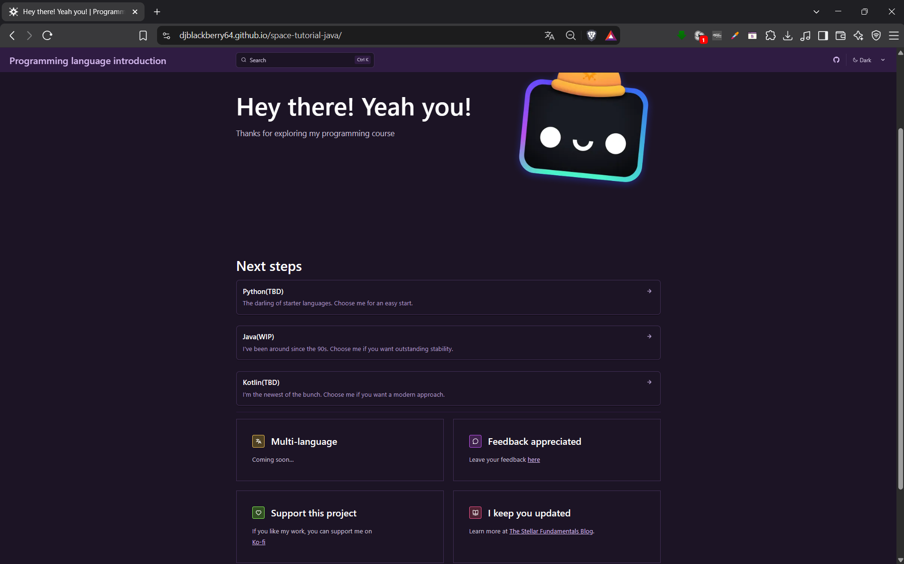

# Space Tutorial Java

## Welcome to this course

Hello and welcome to this project. A bit contrary to the name, this course doesn't exclusively cover the Java language but its the most fleshed out of the 3 that are covered.

## What you should know beforehand

This is a course that:

- Is still in development
- Aims to introduce programming languages with bite-sized lessons
- Is only available in English

## Why or how is this useful to you?

This course is great if you just wanna get to know one of the 3 languages (Java, Kotlin or Python) and their syntax a little bit.

Currently there're some introductionary "Hello World!" lessons available, with more lessons in development.

Setup is described for Java and will be added to the other languages as well.

### A quick look at the project

<a href="https://djblackberry64.github.io/space-tutorial-java/">Hosted course online</a>

## How to self-host this project

- Fork this repo
- run `npm install` to install all dependencies
- change the `site` attribute to your url in `astro.config.mjs`
- change the `base` attribute to your subdirectory/repo name in `astro.config.mjs`
- Host the project at your provider of choice by following the deployment documentation of Astro [found here](https://docs.astro.build/en/guides/deploy/) |

## 👀 Still got questions?

Check out [Starlight’s docs](https://starlight.astro.build/), read [the Astro documentation](https://docs.astro.build), or jump into the [Astro Discord server](https://astro.build/chat).

## "I wanna use the assets in this course for commercial purposes"

Hey I don't mind you using the assets for your non-commercial projects. 

However, if you wanna use them commercially visit [Ko-fi](https://ko-fi.com/djblackberry64) for a commercial license. 

Take care and good luck with your projects!

## History

- Started June 1st 2026 during the HackClub event "Stardance"
